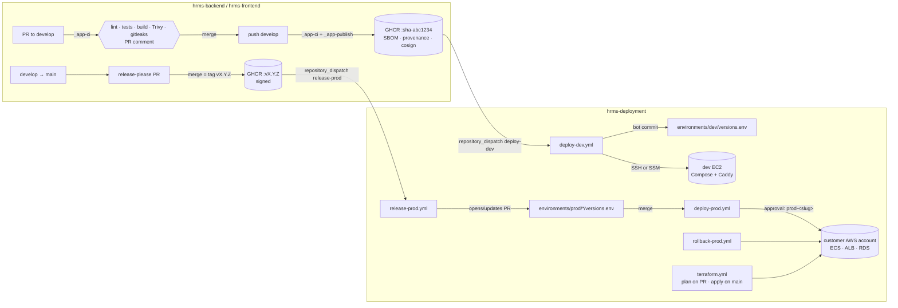
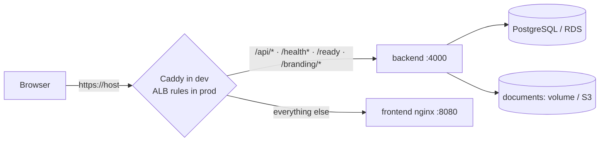

# Delivery architecture

Three repositories:

| Repo | Contains | Produces |
|---|---|---|
| `hrms-backend` | Fastify API, migrations, DB tooling | `ghcr.io/rgrishabh/hrms-backend` |
| `hrms-frontend` | React SPA, nginx config, runtime renderer | `ghcr.io/rgrishabh/hrms-frontend` |
| `hrms-deployment` | environments (versions as code), Terraform, scripts, **reusable workflows** | deployments |

HRMS is white-label with **one installation per customer**. Dev is one EC2 host with Docker Compose. Each production
customer has **its own AWS account** (ECS Fargate, ALB, RDS, S3), described by `terraform/customers/<slug>.tfvars`
and `environments/prod/<slug>/versions.env`. The same two images serve every installation; configuration is injected at runtime.

## Code → image → dev → prod

## Same origin, two images

The session cookie and CSRF header require the SPA and the API on one origin. The proxy routes by path.

The frontend renders `index.html` (title, theme colour, favicon), `/env.js` and its CSP at container start, so no
per-customer build exists. The backend serves runtime branding at `/api/v1/public/config` and branding files at `/branding/*`.

## Dev deploy

1. An app push to `develop` → image `:sha-<short>` → `repository_dispatch deploy-dev {app, tag}`.
2. `deploy-dev.yml` (concurrency `deploy-dev`) commits the tag into `environments/dev/versions.env`.
3. It connects to the host by SSH with a **pinned host key** (or SSM Run Command via OIDC), runs `bootstrap-ec2.sh`
   (idempotent), syncs `environments/dev/`, writes `.env` from `DEV_ENV_FILE` (mode 600), and logs in to GHCR with the run's token.
4. On the host, `deploy-dev.sh` pulls, runs `provision` and `migrate` as one-off containers, starts the stack, creates
   the first admin once, waits for `/ready` and frontend health, and prunes images (keeps 3).
5. The runner smoke-tests `https://dev.rgrishabh.in`. On any failure it redeploys the previous versions, reverts the
   commit and fails the run.

## Prod deploy

1. Merging the release-please PR tags `vX.Y.Z` → signed `:vX.Y.Z` → `repository_dispatch release-prod`.
2. `release-prod.yml` opens or updates **one PR per app** that bumps every enabled customer, with release notes and a
   link to the dev run of the same commit.
3. Merging the PR → `deploy-prod.yml` → one job per changed customer in environment `prod-<slug>`. **Your approval is the only human step**
   (several customers can be approved in one dialog).
4. Per customer:
   1. Verify the cosign signatures. The image must be signed by `hrms-deployment/_app-publish.yml@main` and built from its own repo.
   2. Pin the image digests.
   3. Assume `hrms-release` via OIDC and check the account id.
   4. Run `deploy-prod.sh`: RDS snapshot, `provision`/`migrate`/`bootstrap` as one-off ECS tasks (abort on failure),
      register task definitions, update both services, wait for stability, check for circuit-breaker rollback, then smoke test.
5. On failure:
   - Both services go back to their previous task definitions.
   - The bot reverts that customer's `versions.env`.
   - Alerts go to SNS and the optional webhook.

## Security properties

- **Credentials:** no long-lived cloud keys anywhere; AWS access is OIDC only, and each account's role is trusted for one repo and environment.
- **Images:** only immutable tags are deployed (`sha-*`, `vX.Y.Z`; `latest` and `develop` are refused). Prod pulls by digest after signature verification.
- **Actions:** third-party actions are pinned to commit SHAs. Every workflow declares least-privilege `permissions`, concurrency and timeouts.
- **Secrets:** stored only in GitHub Environments and AWS Secrets Manager. `.env` is written on the host with mode 600 and is never committed (gitleaks in CI).
- **Database credentials:** the long-running backend never holds the database owner credentials. Migrations run in one-off containers or tasks.
- **Backups:** dev takes nightly `pg_dump` + documents tarballs (optional S3 copy). RDS has automated backups, AWS Backup, and a snapshot before each release.
